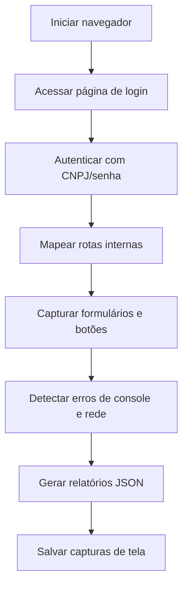
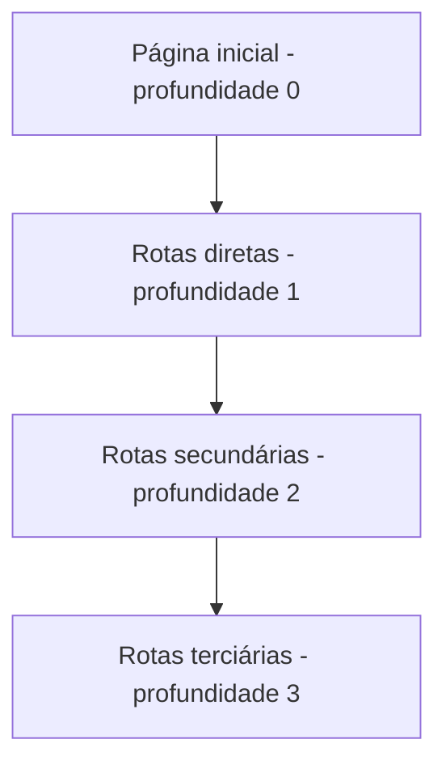
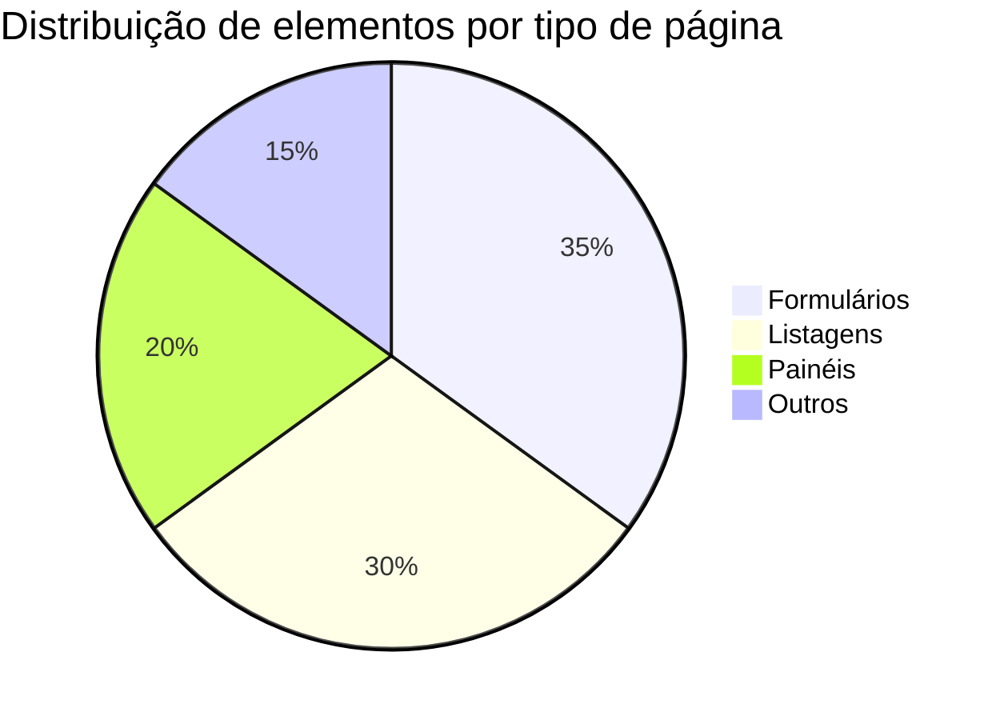

# Bot de Teste Automatizado — Portal de Representação Comercial

Bot de teste automatizado para portal web, com foco em autenticação por CNPJ e análise profunda das funcionalidades acessíveis após o login.

## Objetivo

- Autenticar no portal via login por CNPJ/senha
- Analisar as telas e funcionalidades acessíveis após o login (catálogo, pedidos, comissões, relatórios)
- Registrar erros de console, falhas de requisição e estruturas de formulários encontrados
- Gerar um mapa do site (sitemap) e capturas de tela por rota para uso como referência na construção de uma plataforma similar

## Stack

- Python 3.10+
- Playwright (automação de navegador)
- python-dotenv (variáveis de ambiente)
- pytest (testes unitários)

## Estrutura de diretórios

```
bot-teste-portal/
├── bots/
│   ├── __init__.py
│   ├── main.py
│   ├── registrar_conta.py
│   ├── fazer_login.py
│   ├── analisar_plataforma.py
│   └── crawler.py
├── tests/
│   ├── __init__.py
│   └── test_crawler.py
├── assets/
├── reports/
├── .env.example
├── .env (ignorado pelo git)
├── .gitignore
├── pyproject.toml
└── README.md
```

## Configuração

Copie o exemplo de variáveis de ambiente:

```bash
cp .env.example .env
```

Edite o arquivo `.env` com os valores do seu ambiente. O arquivo `.env` está no `.gitignore` e nunca deve ser versionado.

| Variável | Descrição | Obrigatório |
|---|---|---|
| `BASE_URL` | URL base do portal | Sim |
| `LOGIN_URL` | URL da página de login | Sim |
| `LOGIN_CNPJ` | CNPJ usado para autenticação | Sim |
| `LOGIN_SENHA` | Senha usada para autenticação | Sim |
| `HEADLESS` | Executa o browser sem interface (`true`/`false`) | Não |
| `PASTA_RELATORIOS` | Diretório de saída dos relatórios | Não |

> **Segurança:** nunca informe credenciais reais no `.env.example` e nunca faça commit do `.env`. Mantenha senhas fora do repositório.

## Execução

```bash
uv sync
uv run playwright install chromium
uv run python -m bots.main
```

Ou via console script:

```bash
bot-teste
```

## Relatório gerado

- `reports/analise.json`: estado capturado das rotas visitadas após o login
- `reports/sitemap.json`: varredura controlada da estrutura do site com profundidade e metadados
- `reports/screenshots/`: capturas de tela por rota e por crawler

## Gráficos de resultados (exemplos genéricos)

Os diagramas abaixo ilustram a estrutura de saída do bot e mésticas típicas de uma varredura. Eles não contêm dados do portal alvo.

### Fluxo de automação



### Camadas de profundidade do crawler



### Exemplo de dashboard de métricas (representativo)



## Fluxo de automação

1. Acessar a página de login definida em `LOGIN_URL`
2. Autenticar com `LOGIN_CNPJ` e `LOGIN_SENHA`
3. Navegar para a página inicial após o login
4. Coletar links internos acessíveis
5. Executar varredura controlada das rotas descobertas
6. Capturar formulários, botões, textos, erros de console e falhas de requisição
7. Salvar relatórios em JSON e capturas de tela por rota

## Testes

Executar a suíte de testes unitários:

```bash
uv run pytest
```

## Segurança e uso responsável

- Execute varreduras apenas em portais dos quais você tem autorização explícita
- Respeite o `robots.txt` e adicione intervalos entre requisições para não sobrecarregar o servidor
- Não inclua senhas, tokens ou dados pessoais reais nos relatórios gerados
- Os relatórios e capturas ficam locais e não devem ser publicados sem revisão
