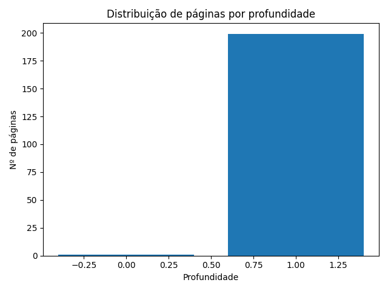
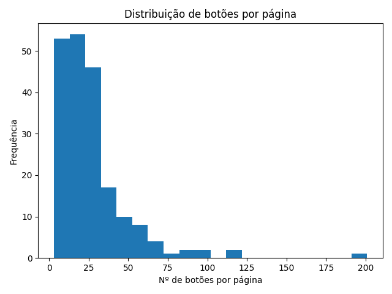
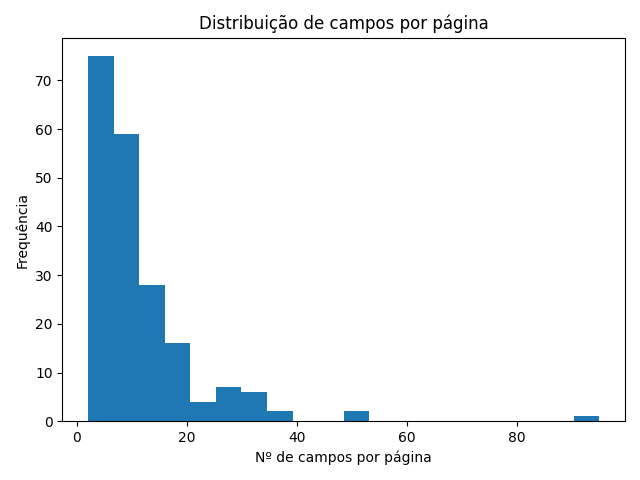

# Bot de Teste Automatizado

Bot de teste automatizado para portal web, com foco em cadastro de conta e análise profunda das funcionalidades.

## Objetivo

- Criar uma conta automaticamente no fluxo `/entrar?volta=%2F`
- Analisar as telas e funcionalidades acessíveis após o login
- Registrar erros, falhas de requisição e estruturas de formulários encontradas

## Stack

- Python 3.10+
- Playwright (browser automation)
- python-dotenv

## Estrutura

```
bot-teste-portal/
├── bots/
│   ├── __init__.py
│   ├── main.py
│   ├── registrar_conta.py
│   ├── analisar_plataforma.py
│   └── crawler.py
├── assets/
├── reports/
├── .env.example
├── .gitignore
├── pyproject.toml
└── README.md
```

## Configuração

```bash
cp .env.example .env
```
Edite `.env` com as variáveis abaixo. `.env` está no `.gitignore`.

| Variável | Descrição |
| --- | --- |
| `BASE_URL` | URL base do portal |
| `HEADLESS` | Executa o browser sem interface |
| `SENHA_CONTA` | Senha criada para a conta de teste |
| `NOME_TESTE` | Nome do responsável na conta |
| `TELEFONE_TESTE` | Telefone/WhatsApp do responsável |
| `PASTA_RELATORIOS` | Diretório de saída dos relatórios |

## Execução

```bash
uv sync
uv run playwright install chromium
uv run python -m bots.main
```

Ou via console script:

```bash
bot-teste
```

## Relatório

- `reports/analise.json`: snapshots das rotas iniciais visitadas
- `reports/sitemap.json`: varredura controlada da estrutura do site com profundidade e metadados
- `reports/screenshots/`: capturas de tela por rota e por crawler

## Resultados da Execução

Visão analítica da varredura automatizada.

**Cobertura**


**Elementos por página**



Métricas resumidas da última execução:
- Páginas mapeadas: 200
- Profundidade máxima: 3
- Média de botões por página: ~26
- Média de campos por página: ~11
- Erros de console: 0
- Falhas de requisição: 0

## Fluxo

1. Navega para `/entrar?volta=%2F`
2. Executa a aba `Criar conta`
3. Preenche nome, telefone, e-mail e senha
4. Submete o formulário
5. Navega para `/` e coleta links internos
6. Executa o ciclo de análise nas rotas descobertas
7. Salva relatórios e capturas
